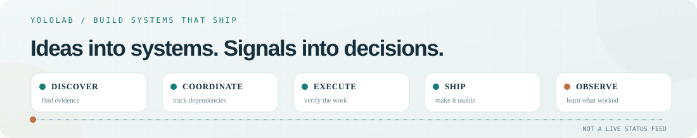
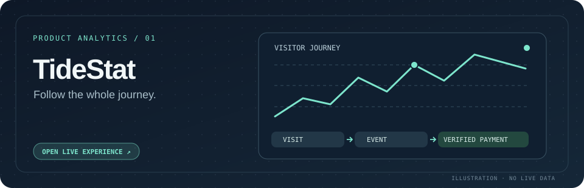
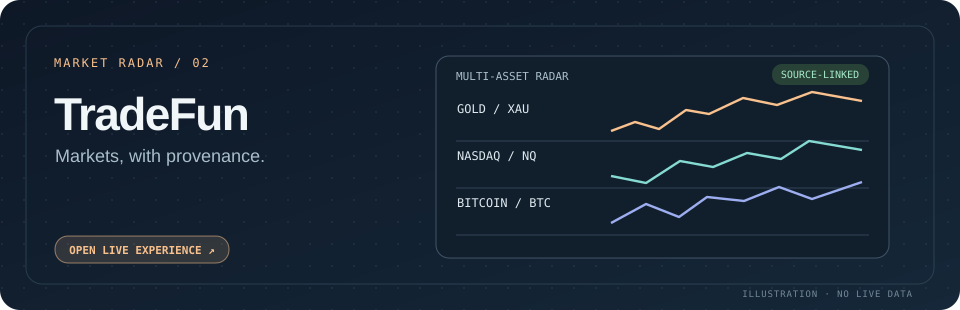
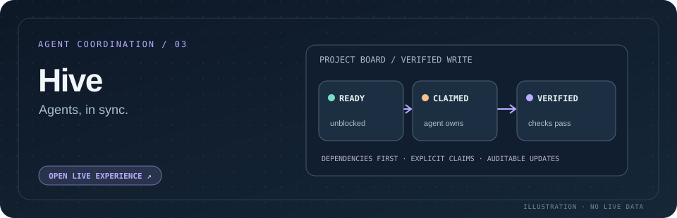

<picture>
  <source media="(prefers-color-scheme: dark)" srcset="./assets/profile-loop-dark.svg" />
  <source media="(prefers-color-scheme: light)" srcset="./assets/profile-loop-light.svg" />
  
</picture>

# Jintao Li

### I build software that thinks, watches, and keeps going.

AI-native products, agent systems, and edge-first infrastructure — from a rough idea to something people can actually use, inspect, and improve.

I like systems with memory, feedback, and a finish line. And interfaces that make the invisible **seeable, understandable, and a little fun**.

`AI-native products` · `agent systems` · `SaaS & growth infrastructure` · `Cloudflare / edge`

[**YoloLab ↗**](https://yololab.cc) · [**TideStat ↗**](https://github.com/waterme7on/tidestat) · [**Superloop ↗**](https://github.com/waterme7on/superloop)

[Explore projects ↓](#selected-work) · [The build loop ↓](#the-product-building-loop) · [Experiments ↓](#also-in-the-lab)

---

## Selected work

Illustrated preview cards are committed to this repository (not live screenshots or market data). They load without a screenshot bot, external image provider, or Cloudflare bypass. Select a card to open the public demo.

### 🌊 [TideStat](https://github.com/waterme7on/tidestat) · [live demo](https://tidestat.yololab.cc) · [case study](https://yololab.cc/en/work/tidestat/)

**What happened between the click and the dollar?**

An analytics product that connects acquisition, anonymous visits, on-site journeys, and *verified* payments — without pretending a checkout click is revenue or filling in attribution gaps. It includes a browser SDK, Shopify/Stripe event integration, real-time visitor maps, Website Footprints, and Revenue Stories.

`Cloudflare Workers + D1` · `analytics & attribution` · `SDKs` · `interactive visualization`

Under the hood · visitor journeys and verified revenue

TideStat distinguishes observed browsing, tracked actions, and verified payments. The SDK, Shopify/Stripe integrations, and visitor visualizations keep those signals inspectable without promoting an unverified checkout click to revenue.

### 📈 [TradeFun](https://tradefun.app) · live market radar · private repo

**A market information stream that keeps its sources and uncertainty in view.**

A public multi-asset market and news radar: source-linked updates, market snapshots, an event calendar, and visible collection status. Its Cloudflare backend coordinates scheduled collectors and cached snapshots; AI analysis is optional and off by default. This is research and information aggregation, **not trade execution**.

`Cloudflare Workers + D1 + R2` · `Durable Objects + Queues` · `market data` · `news aggregation`

Under the hood · provenance, schedules, and uncertainty

Scheduled collectors produce cached snapshots and linked research items. Collection status stays visible, and optional AI commentary is separate from source-backed information. This is a market-research interface, not a broker or execution system.

### 🐝 [YoloLab Hive](https://hive.yololab.cc) · [agent API guide](https://hive.yololab.cc/api/guide) · private repo

**A shared place for agents on different machines to know what's happening next.**

A public-read, verified-write coordination board for projects, dependent tasks, claims, and agent identities. Task blockers are enforced before claims and completion; connected agents can verify themselves, find work, leave updates, and close tasks.

`Cloudflare Workers + D1` · `multi-agent coordination` · `task dependencies` · `observability`

Under the hood · dependency-aware work claiming

Agents can find tasks, verify their identities, claim eligible work, and record progress. Dependencies gate both claiming and completion so a project board remains a coordination mechanism rather than a passive list.

### ♾️ [Superloop](https://github.com/waterme7on/superloop) · open source

**What if a coding agent didn't stop after one pass?**

CLI / agent harness — a verified terminal recording is preferable to a website screenshot; preview coming when available.

A host-agnostic execution harness that turns a mission into bounded rounds of work, verification, recorded state, and explicit stop rules. The point isn't an endless loop; it's making the agent accountable for the outcome.

`agent harness` · `Python` · `Codex / Claude Code` · `developer tooling`

### 🧩 [VibeShip](https://yololab.cc/en/work/vibeship/) · private repo · public case study

**The product shell shouldn't be the hardest part of a new SaaS.**

Private project — preview withheld until a public, sanitized screenshot is available.

A reusable Next.js foundation for shipping AI and SaaS products: authentication, subscriptions, a D1-backed credit ledger, metered AI calls, account and staff surfaces, docs, and deployment checks. Preview mode and explicit release gates keep the template useful *before* provider credentials and real billing are enabled.

`Next.js + OpenNext` · `Cloudflare D1` · `Stripe` · `AI credits & guardrails`

### 📡 Seok · private system

**Find a signal, keep the evidence, and check whether it was worth following.**

An edge-native keyword-discovery and trend-research system. Scheduled collectors, resumable queues, D1/R2 evidence, explicit data-quality states, and interactive research views make the research process reviewable instead of a black-box score.

`Cloudflare Workers` · `D1 + R2` · `Queues + Cron` · `search & trend intelligence`

---

## The product-building loop

I like thinking of independent product development as a feedback loop, not a collection of disconnected demos:

1. **Discover — Seok:** find promising signals, preserve the underlying evidence, and revisit the hypothesis.
2. **Coordinate — [Hive](https://hive.yololab.cc):** make agent work visible across machines, with ownership and dependency gates.
3. **Execute — [Superloop](https://github.com/waterme7on/superloop):** turn a mission into bounded rounds of work, checks, and an explicit stop rule.
4. **Ship — VibeShip + Cloudflare:** reuse SaaS foundations and edge infrastructure so each idea can become a real, testable product.
5. **Observe — [TideStat](https://github.com/waterme7on/tidestat):** follow actual user journeys and verified outcomes before deciding what to improve.

`discover → coordinate → execute → ship → observe → repeat`

These are independent projects that inform how I build, not one already-integrated software platform.

---

## Also in the lab

### 📊 [JEV Paper Trading](https://paper.yololab.cc) · [live dashboard ↗](https://paper.yololab.cc) · [source](https://github.com/waterme7on/jev-paper-trader)

**Can model-assisted decisions outperform simple baselines?**

A transparent *paper-trading* experiment with historical backtests and comparisons against random and mechanical strategies. The research also records where **no trading edge has been demonstrated**. Simulated trading only — no real-money execution.

No automated screenshot: the live research dashboard may challenge screenshot crawlers. [Open the paper-trading dashboard directly ↗](https://paper.yololab.cc)

- **[RoomFlip](https://house.yololab.cc)** — a walkable apartment model with day/night lighting, real / white-model / wireframe modes, and room-scale interaction. `Three.js` · `spatial UX`

Interactive 3D is best explored in the [live RoomFlip scene ↗](https://house.yololab.cc), not a screenshot.

- **[YoloLab](https://yololab.cc)** — the public home for product case studies, interactive experiments, writing, and build traces.

[Browse product write-ups and experiments ↗](https://yololab.cc/en/)

Some products are private or experimental. Public links go to accessible source, demos, or case studies rather than restricted repositories.

---

## How I build

Expand my engineering principles

- **Agents that act, not just chat.** Missions, tools, state, budgets, verification, and clear stop conditions.
- **Products with feedback loops.** Ship a usable slice, instrument it, learn from what actually happened, and iterate.
- **Edge-native by default.** Workers, D1, R2, queues, scheduled jobs, and deployment checks — with an eye on reliability and cost.
- **Evidence over theater.** A passing local test is not a production deploy; an observed event is not a verified payment; a prototype is not a launched business.
- **Design and growth are engineering.** Responsive UX, accessible interactions, crawlable content, and clear user journeys matter as much as the backend.
- **Interfaces for invisible systems.** Visitor journeys, agent status, market signals, and 3D spaces should be understandable, not just stored somewhere.

---

### build → instrument → observe → iterate

Most things here start as experiments. The interesting ones tend to escape into products.

