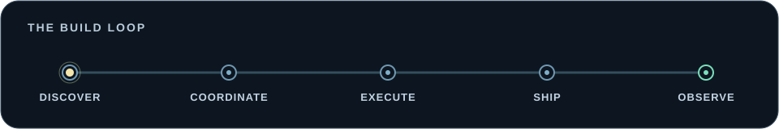

# Jintao Li

### I build software that thinks, watches, and keeps going.

AI-native products, agent systems, and edge-first infrastructure — from a rough idea to something people can actually use, inspect, and improve.

I like systems with memory, feedback, and a finish line. And interfaces that make the invisible **seeable, understandable, and a little fun**.

`AI-native products` · `agent systems` · `SaaS & growth infrastructure` · `Cloudflare / edge`

[**YoloLab ↗**](https://yololab.cc) · [**TideStat ↗**](https://github.com/waterme7on/tidestat) · [**Superloop ↗**](https://github.com/waterme7on/superloop)

Animation is decorative and respects reduced-motion settings. Everything works without scripts or external screenshot services.

**Explore:** [Selected work](#selected-work) · [Product loop](#the-product-building-loop) · [Other experiments](#also-in-the-lab) · [How I build](#how-i-build)

---

## Selected work

Click a project illustration to visit its public demo. These are original, self-hosted SVG illustrations — not screenshots, live data, or captures of private dashboards.

### 🌊 [TideStat](https://github.com/waterme7on/tidestat) · [live demo](https://tidestat.yololab.cc) · [case study](https://yololab.cc/en/work/tidestat/)

**What happened between the click and the dollar?**

Analytics that traces journeys all the way to verified payments.

Inside the project · product and technical notes

An analytics product that connects acquisition, anonymous visits, on-site journeys, and *verified* payments — without pretending a checkout click is revenue or filling in attribution gaps. It includes a browser SDK, Shopify/Stripe event integration, real-time visitor maps, Website Footprints, and Revenue Stories.

`Cloudflare Workers + D1` · `analytics & attribution` · `SDKs` · `interactive visualization`

### 📈 [TradeFun](https://tradefun.app) · live market radar · private repo

**A market information stream that keeps its sources and uncertainty in view.**

A source-linked market and news radar, not a trading terminal.

Inside the project · product and technical notes

A public multi-asset market and news radar: source-linked updates, market snapshots, an event calendar, and visible collection status. Its Cloudflare backend coordinates scheduled collectors and cached snapshots; AI analysis is optional and off by default. This is research and information aggregation, **not trade execution**.

`Cloudflare Workers + D1 + R2` · `Durable Objects + Queues` · `market data` · `news aggregation`

### 🐝 [YoloLab Hive](https://hive.yololab.cc) · [agent API guide](https://hive.yololab.cc/api/guide) · private repo

**A shared place for agents on different machines to know what's happening next.**

A public-read coordination board for agents across machines.

Inside the project · product and technical notes

A public-read, verified-write coordination board for projects, dependent tasks, claims, and agent identities. Task blockers are enforced before claims and completion; connected agents can verify themselves, find work, leave updates, and close tasks.

`Cloudflare Workers + D1` · `multi-agent coordination` · `task dependencies` · `observability`

### ♾️ [Superloop](https://github.com/waterme7on/superloop) · open source

**What if a coding agent didn't stop after one pass?**

A bounded agent execution harness with verification and stop rules.

Inside the project · product and technical notes

CLI / agent harness — a verified terminal recording is preferable to a website screenshot; preview coming when available.

A host-agnostic execution harness that turns a mission into bounded rounds of work, verification, recorded state, and explicit stop rules. The point isn't an endless loop; it's making the agent accountable for the outcome.

`agent harness` · `Python` · `Codex / Claude Code` · `developer tooling`

### 🧩 [VibeShip](https://yololab.cc/en/work/vibeship/) · private repo · public case study

**The product shell shouldn't be the hardest part of a new SaaS.**

Reusable account, billing, and credit foundations for AI SaaS.

Inside the project · product and technical notes

Private project — preview withheld until a public, sanitized screenshot is available.

A reusable Next.js foundation for shipping AI and SaaS products: authentication, subscriptions, a D1-backed credit ledger, metered AI calls, account and staff surfaces, docs, and deployment checks. Preview mode and explicit release gates keep the template useful *before* provider credentials and real billing are enabled.

`Next.js + OpenNext` · `Cloudflare D1` · `Stripe` · `AI credits & guardrails`

### 📡 Seok · private system

**Find a signal, keep the evidence, and check whether it was worth following.**

An evidence-first system for keyword and trend discovery.

Inside the project · product and technical notes

An edge-native keyword-discovery and trend-research system. Scheduled collectors, resumable queues, D1/R2 evidence, explicit data-quality states, and interactive research views make the research process reviewable instead of a black-box score.

`Cloudflare Workers` · `D1 + R2` · `Queues + Cron` · `search & trend intelligence`

---

## The product-building loop

I like thinking of independent product development as a feedback loop, not a collection of disconnected demos:

1. **Discover — Seok:** find promising signals, preserve the underlying evidence, and revisit the hypothesis.
2. **Coordinate — [Hive](https://hive.yololab.cc):** make agent work visible across machines, with ownership and dependency gates.
3. **Execute — [Superloop](https://github.com/waterme7on/superloop):** turn a mission into bounded rounds of work, checks, and an explicit stop rule.
4. **Ship — VibeShip + Cloudflare:** reuse SaaS foundations and edge infrastructure so each idea can become a real, testable product.
5. **Observe — [TideStat](https://github.com/waterme7on/tidestat):** follow actual user journeys and verified outcomes before deciding what to improve.

`discover → coordinate → execute → ship → observe → repeat`

These are independent projects that inform how I build, not one already-integrated software platform.

---

## Also in the lab

### 📊 [JEV Paper Trading](https://paper.yololab.cc) · [live dashboard ↗](https://paper.yololab.cc) · [source](https://github.com/waterme7on/jev-paper-trader)

**Can model-assisted decisions outperform simple baselines?**

A transparent *paper-trading* experiment with historical backtests and comparisons against random and mechanical strategies. The research also records where **no trading edge has been demonstrated**. Simulated trading only — no real-money execution.

Concept illustration (not a live performance chart). [Open the paper-trading dashboard directly ↗](https://paper.yololab.cc)

- **[RoomFlip](https://house.yololab.cc)** — a walkable apartment model with day/night lighting, real / white-model / wireframe modes, and room-scale interaction. `Three.js` · `spatial UX`

- **[YoloLab](https://yololab.cc)** — the public home for product case studies, interactive experiments, writing, and build traces.

All visuals above are conceptual artwork, not application screenshots. Private and experimental projects only link to public demos, repositories, or case studies.

---

## How I build

- **Agents that act, not just chat.** Missions, tools, state, budgets, verification, and clear stop conditions.
- **Products with feedback loops.** Ship a usable slice, instrument it, learn from what actually happened, and iterate.
- **Edge-native by default.** Workers, D1, R2, queues, scheduled jobs, and deployment checks — with an eye on reliability and cost.
- **Evidence over theater.** A passing local test is not a production deploy; an observed event is not a verified payment; a prototype is not a launched business.
- **Design and growth are engineering.** Responsive UX, accessible interactions, crawlable content, and clear user journeys matter as much as the backend.
- **Interfaces for invisible systems.** Visitor journeys, agent status, market signals, and 3D spaces should be understandable, not just stored somewhere.

---

### build → instrument → observe → iterate

Most things here start as experiments. The interesting ones tend to escape into products.

